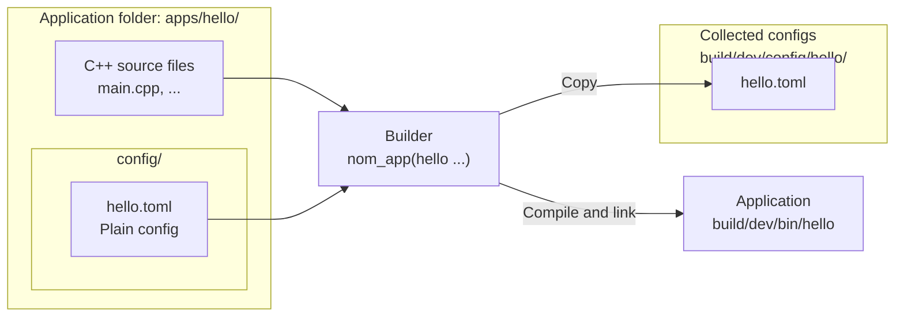
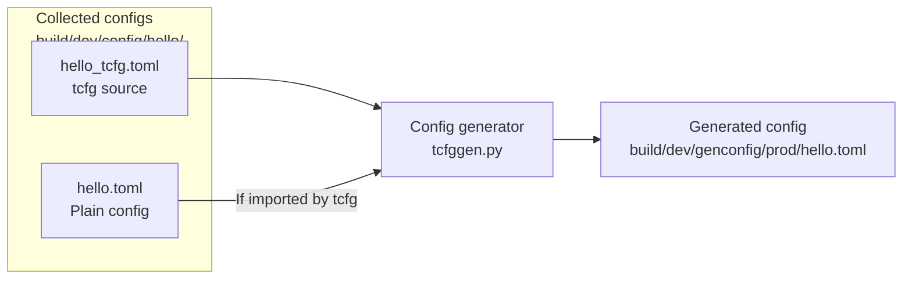

# Introduction to toml_config

> **Documentation review draft — implementation pending.** This page defines the
> target contract. Commands and APIs below are implementation acceptance criteria,
> not claims that this checkout already supports them. See [status](../../TODO.md).

**toml_config** is Nomisma's TOML configuration framework for C++ applications.
It loads settings into typed C++ structures, validates them before application
startup, and generates configuration variants from structured configs.

## Beginner introduction

If you are new to the platform, you can start building and running apps without
learning how `toml_config` works. Using it is optional. However, `toml_config` is
designed to integrate with Nomisma's build system and application workflow, so adding
full configuration support to an app is relatively simple.

You can start with ordinary TOML files; config generation is optional. When you
need structured configs or configurations for different environments, these
conventions provide a starting point:

1. An application's config files live in a `config/` subdirectory of its app folder.
2. A config file normally shares the executable's name: for an app named `hello`,
   the config file is `hello.toml`.
3. The build system copies config files into the build directory, ready for use
   when running the app. Config generation can also be enabled when needed.
4. Applications using the loader find their config according to the
   [config resolution rules](app_config_binding.md#config-resolution).
   You can also select a file explicitly with `--config FILE`.
5. In C++, the `NOM_TCONFIG` macro declares the mapping between TOML fields and a
   config structure. The loader reads the TOML and maps its values into that structure.

The diagram uses an app named `hello` and the `dev` build preset.

### Build and collection



`nom_app()` builds the application and collects its config files unchanged.

## Enabling configuration in your app

### 1. Define the config file

The following walkthrough defines the planned
[config_workflow_example](../../apps/config_workflow_example/README.md), with acceptance
commands to run after implementation. Use the same approach in your own app. Run
commands from the repository root; see [Build](../../README.md#build) for initial setup.

Choose the parameters your app needs and put them in a TOML file inside the app's
`config/` folder. Name the file after the executable: an app named `hello` normally
uses `config/hello.toml`.

For `config_workflow_example`, the file is
[apps/config_workflow_example/config/config_workflow_example.toml](../../apps/config_workflow_example/config/config_workflow_example.toml):

```toml
endpoint = "https://example.test/feed"
timeout_s = 10
enabled = true
```

These settings describe the connection endpoint, timeout, and whether the feature
is enabled. You can edit this file directly; generation is not needed to load it.

### 2. Build and select the config

For an app declared with `nom_app()`, the build system automatically copies the
adjacent `config/` folder into the build directory. The app declaration also links
the configuration library:

```cmake
nom_app(config_workflow_example IMPORT_STD SOURCES main.cpp DEPS nom::toml_config)
```

Build the example:

```bash
cmake --preset dev
cmake --build --preset dev --target config_workflow_example
```

The resulting locations are:

| Item | Path |
|---|---|
| Executable | `build/dev/bin/config_workflow_example` |
| Collected config | `build/dev/config/config_workflow_example/config_workflow_example.toml` |

The collected file is a copy; edit the source file and rebuild to refresh it.
To select that file when starting the app, pass its path explicitly:

```bash
build/dev/bin/config_workflow_example \
    --config build/dev/config/config_workflow_example/config_workflow_example.toml
```

For automatic lookup by executable name, point `NOM_CONFIG_DIR` at the collected
config directory:

```bash
NOM_CONFIG_DIR="$PWD/build/dev/config" build/dev/bin/config_workflow_example
```

For an executable named `<app>`, the loader looks for `<app>.toml`, then
`<app>/<app>.toml`, within each search directory. Collection does not itself add
the build directory to the runtime search path. An explicit `--config FILE`
takes precedence over environment settings; see the
[config resolution rules](app_config_binding.md#config-resolution)
for the full lookup order. The
[Bash helpers](app_config_binding.md#selecting-search-directories-in-bash)
provide `cfg_set`, `cfg_add`, `cfg_print`, and `cfg_clear` for managing search
directories in your shell.

Both commands above load the same file. The example prints the selected path and
`Application initialized; timeout: 10 seconds`. It simulates startup without
connecting to the endpoint.

### 3. Map and use the config in C++

Define a C++ structure for the settings and use `NOM_TCONFIG` to map its members to
TOML keys. In the example, this declaration lives in
`../../apps/config_workflow_example/main.cpp`:

```cpp
#include <toml_config/config.h>

import std;
import nom.toml_config;

namespace example
{
    using namespace nom::cfg_types;

    struct app_config
    {
        cfg_defaulted<cfg_string> endpoint{"https://example.test/feed"};
        cfg_defaulted<cfg_int> timeout_s{10};
        cfg_defaulted<cfg_bool> enabled{true};
        cfg_optional<cfg_string> interface_name;

        std::expected<void, std::string> validate() const
        {
            if (endpoint->empty() || *timeout_s <= 0)
            {
                return std::unexpected("endpoint must be nonempty and timeout_s must be positive");
            }
            return {};
        }
    };

    NOM_TCONFIG(app_config, endpoint, timeout_s, enabled, interface_name)
}
```

The TOML keys match the member names. `cfg_defaulted` keeps the C++ default when
a key is absent; `cfg_optional` allows `interface_name` to be absent. The
`validate()` function checks the application's rules after mapping.

Inside `main()`, parse the config arguments and load the typed configuration:

```cpp
const auto arguments = nom::tcfg::parse_config_arguments(argc, argv, NOM_CONFIG_KEY_VALUE);
const auto loaded = nom::tcfg::load_config<example::app_config>(arguments.options);
const auto& config = loaded.value;
```

Use `config` to initialize the application's components. For example,
`*config.timeout_s` contains the timeout from TOML, and `*config.endpoint` contains
the endpoint. `loaded.location` identifies the selected config source and path.
The `../../apps/config_workflow_example/main.cpp` also handles
unexpected arguments, reports loading errors, and exits before initialization
when `--check-config` is requested.

You can validate the config and try a runtime override with:

```bash
build/dev/bin/config_workflow_example \
    --config build/dev/config/config_workflow_example/config_workflow_example.toml \
    --set /timeout_s=20 --check-config
```

This reports the config lookup and final TOML without starting the application.
Use `--check-config=view` for TOML only, or `--check-config=silent` for just `OK`.
A timeout of `0` fails
validation. Overrides apply to this invocation and do not change the TOML file.
See [TOML/C++ mapping](toml_cpp_mapping.md) for required fields,
nested structures, and supported types, and
[application integration](app_config_binding.md#application-integration)
for the loading API.

## Advanced use : Structured configs and variants

As configurations grow, **structured configs** let you break a larger
configuration into parts according to their use or meaning. The **tcfg** language
supports this through inheritance, imports, and overrides. Its Python generator
resolves those instructions into ordinary application TOML that the same C++
loader can use.

For example, you can organize connection and logging parameters separately, or
derive development and production variants from a base config. Start with the
[tcfg language guide](tcfg.md), then see
[config generation](config_generation.md) for the Python tool and
[build integration](build_system_integration.md) for generating
configs through CMake. The generator needs Python 3.11+ and the standard library.

### Config generation

Generation is registered with `nom_tcfg_generate()` and can run on demand or
with the app build. This diagram shows a `prod` config generated from files
collected in the `dev` build:



At startup, the application can load either the collected plain config or a
generated config.
